# Revisión visual con GTT GADD UX

10 de octubre de 2026. Referencia principal confirmada por el usuario: `/Users/eladrodriguez/Sites/gtt-gadd-ux`. Se ejecutó una copia local aislada con su dependencia Tabler resuelta en la copia; no se modificó el repositorio de referencia. Se inspeccionaron `/inicio` e `/interesados` en el navegador integrado.

## Diferencia detectada y corrección

La versión anterior compartía tokens y componentes con GTT, pero la composición seguía Hundrev: menú de 256 px, marca espaciada independiente de la empresa, agrupaciones rotuladas y ausencia del título de página con icono. La búsqueda también mostraba la lupa fuera del input. Estas diferencias explicaban que la experiencia no se pareciera suficientemente a la referencia.

Se adaptó el menú de 196 px, el panel con margen de 4 px y radio de 10 px, la cabecera de 48 px con acción principal, los títulos de 24 px con iconos de 40 px y los listados con avatares circulares de 24 px. El resumen adopta bienvenida centrada, accesos rápidos y módulos de seguimiento. Los datos y las acciones siguen conectados con Laravel.

## Recorrido y evidencia

1. **Referencia y contactos: corregidos.** Comparación a 1280 × 800; alineación de cabecera, título, buscador y tabla. Se mantienen los campos propios del CRM y sus dos contactos demo.

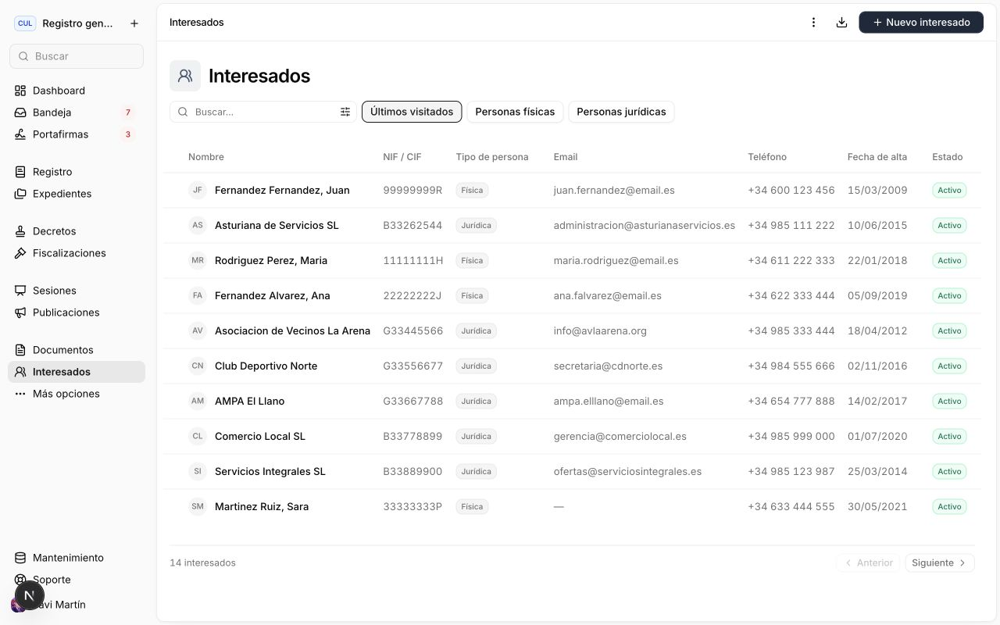

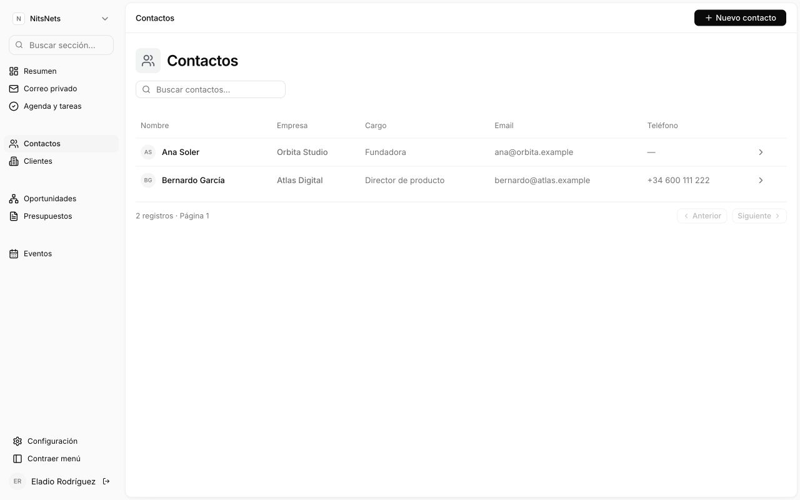

2. **Acceso a registros en la primera revisión (sustituido por páginas en la revisión siguiente).** La búsqueda de Bernardo devolvió únicamente su registro. La acción de cabecera abrió el formulario de alta y se canceló sin crear datos. La ficha mostró afiliación actual, histórica y notas autorizadas. El filtro de tareas completadas devolvió el vacío esperado y se restauró Todos. La búsqueda de secciones dejó únicamente Oportunidades al introducir ese nombre.

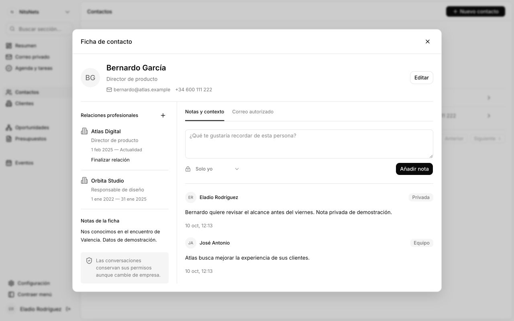

3. **Resumen y navegación: corregidos y funcionales.** Accesos a módulos, menú plegable con iconos y navegación móvil comprobados.

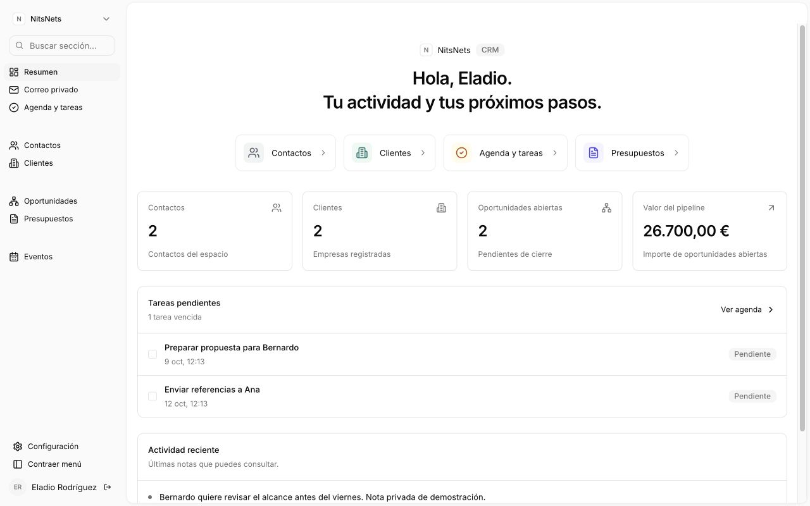

4. **Móvil: sin desbordamiento de página.** Revisión a 390 × 844; apertura del menú y navegación a contactos. La tabla se desplaza horizontalmente dentro de su contenedor: documento de 390 px y tabla de 721 px.

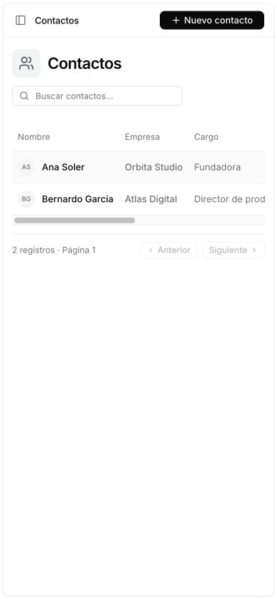

## Comprobaciones y límites

Build de producción y comprobación TypeScript correctos. Los controles mantienen etiquetas accesibles y los filtros exponen su estado pulsado. Esta inspección no constituye una auditoría completa de accesibilidad ni una prueba de todos los flujos del CRM.

Se adapta el lenguaje visual al dominio CRM: no se copian funcionalidades administrativas, métricas ni datos de GTT. La primera revisión conservaba diálogos; la revisión siguiente corrige esa decisión. El acceso mantiene su formulario de contraseña/Google. Esta revisión visual cubre el espacio de trabajo, sin afirmar una reproducción idéntica de todas las pantallas de GTT.

## Segunda revisión: fichas completas y configuración

La corrección del usuario detectó que adaptar el menú no bastaba: GTT organiza el detalle en páginas, mientras el CRM todavía utilizaba modales. Se inspeccionaron una ficha real de `/interesados` y `/preferences`, además de `components/modules/certiac/interesado-ficha.tsx` y las constantes del shell. El color primario se ajusta al valor efectivo de GTT, `#1e293b`.

Todos los registros tienen ahora rutas propias y vistas de lectura separadas de la edición. Contactos incluye datos, relaciones actuales e históricas, notas y correo autorizado; los otros módulos usan secciones equivalentes. Identidad, título de 24 px, ancho de contenido de 896 px, bordes, espaciado y acciones en cabecera proceden de la referencia. Configuración sustituye las tarjetas por filas agrupadas y navegación específica.

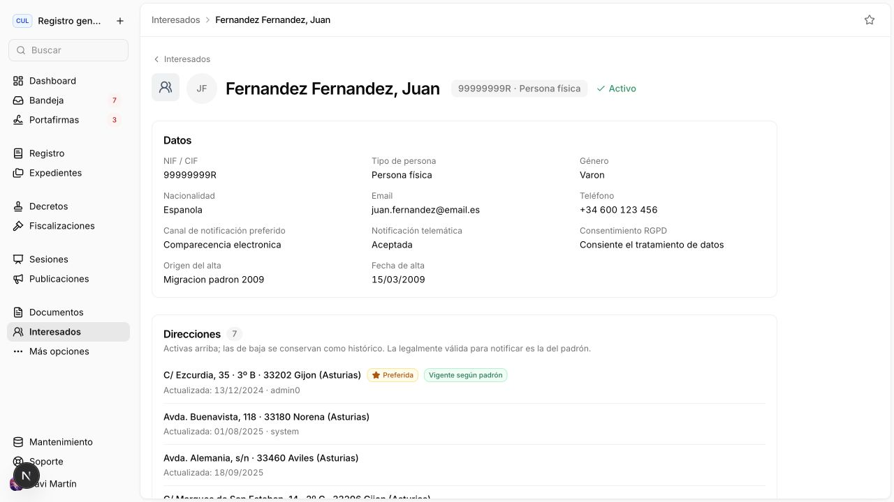

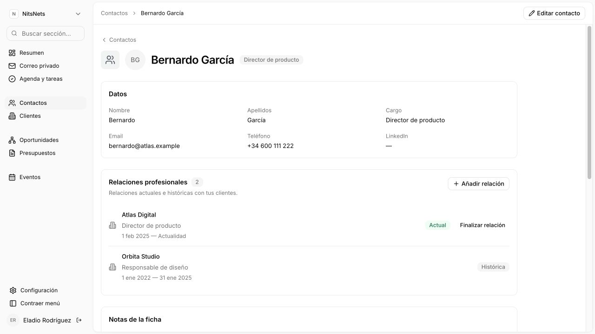

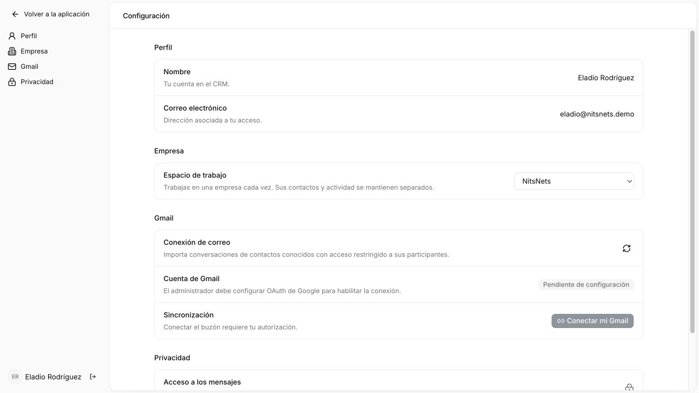

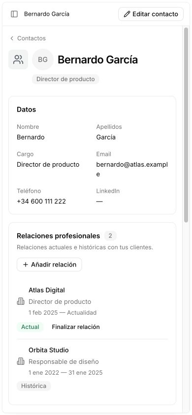

### Verificación de esta revisión

- Recarga directa de contacto, vuelta con Atrás y conservación de búsqueda comprobadas en navegador.
- Alta y edición reales de un contacto temporal desde páginas completas, persistencia comprobada en API y eliminación posterior del dato de prueba.
- Navegación contacto → correo → contacto, contacto → cliente, detalle de presupuesto con partidas y apertura de su editor comprobadas sin modales.
- Menú móvil, ficha y editor a 390 × 844: ancho de documento de 390 px y ningún diálogo de registro abierto. El menú móvil conserva su panel de navegación.
- Suite web: 16 pruebas correctas, 0 fallos; 2 pruebas de integración opcionales omitidas por no activar sus variables. Incluye 5 pruebas nuevas de navegación. TypeScript y compilación de producción correctos. El guardado real se verificó además en navegador y API.

No se modificó el repositorio GTT ni se copiaron sus datos de ejemplo. Esta revisión no configura Google OAuth ni cambia permisos de correo. La inspección visual cubre las pantallas mostradas y no equivale a una auditoría completa de accesibilidad.

## Avisos de error — 11 de octubre de 2026

1. **Antes: defecto confirmado.** En Presupuestos, el mensaje y «Reintentar» compartían el mismo bloque de texto; el botón ghost sin padding parecía parte de la frase. Captura: `verification-errors/01-before.png`.
2. **Escritorio: corregido.** `ErrorBox` utiliza icono, párrafo y botón outline separados. Adapta la estructura de columnas, superficie neutra y radio del `components/ui/alert.tsx` de GTT; conserva los componentes Button del proyecto. Rojo reservado al icono y al borde. El mensaje de conexión ya no pide al usuario comprobar una API. Captura: `verification-errors/02-desktop.png` (error durante la recuperación de sesión).
3. **Móvil: corregido.** A 390 × 844 la acción pasa debajo del mensaje, sin superposición ni desbordamiento horizontal (documento: 390 px). Captura: `verification-errors/03-mobile.png`.

El componente mantiene `role="alert"`, oculta iconos decorativos a lectores y declara `type="button"` en el reintento para evitar envíos accidentales dentro de formularios. La inspección visual no acredita una auditoría completa con lector de pantalla. TypeScript correcto; suite existente: 16 pruebas correctas, 2 integraciones opcionales omitidas. No se alteran contratos ni autorizaciones.

4. **Reintento: correcto.** Se arrancó el servidor local que estaba detenido y se recuperó el listado desde «Reintentar». Se reprodujo también el fallo en el listado mediante una interrupción temporal del servidor de prueba y se verificó de nuevo su recuperación; el servidor queda funcionando y la búsqueda vacía.

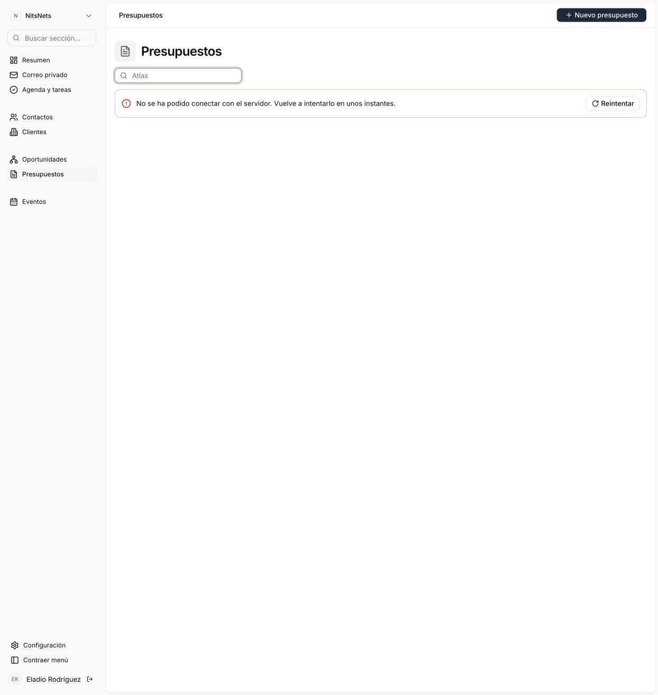

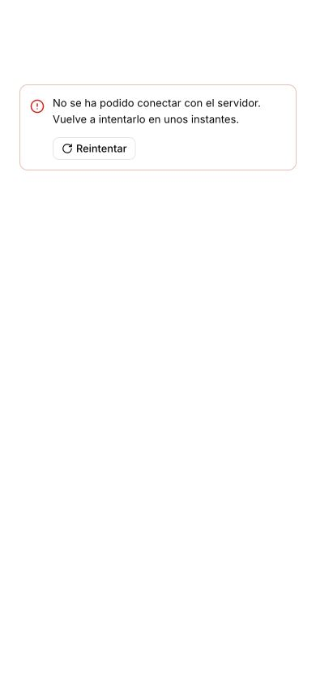
